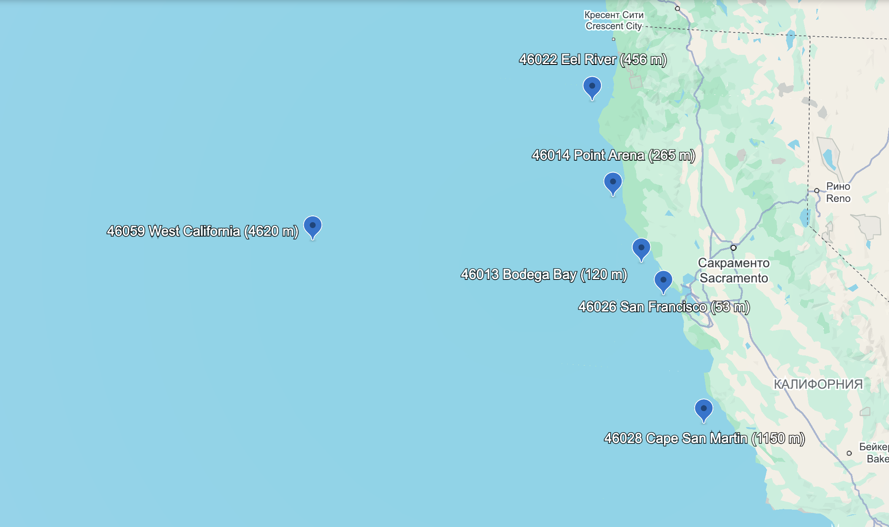

# Прогнозирование высоты морских волн и раннее штормовое предупреждение у побережья Калифорнии (NOAA NDBC)

## 1. Описание проекта и постановка задачи
* **Цель:** Прогнозирование значительной высоты морской волны (`WVHT`, в метрах) на горизонте **3 и 6 часов вперёд** по пространственно-временной телеметрии цепочки океанских и шельфовых буёв у побережья Калифорнии (с прикладным пороговым анализом штормовых тревог для судоходства).
* **Тип ML-задачи:** Пространственно-временная регрессия (краткосрочный прогноз высоты волн с последующей пороговой детекцией штормов).

---

## 2. Сеть станций NOAA NDBC (2021–2025 гг.)
Данные собраны из официального архива [NOAA National Data Buoy Center](https://noaa.gov) (*Standard Meteorological Data*) по 6 станциям:

| ID буя | Название станции | Координаты | Глубина | Роль в пространственной сети |
| :---: | :--- | :---: | :---: | :--- |
| **`46059`** | West California | `38.067° N, 129.895° W` | 4 620 м | Дальний глубоководный дозорный в 357 морских милях от берега (перехватывает шторм за ~14 ч до Сан-Франциско) |
| **`46022`** | Eel River | `40.716° N, 124.540° W` | 456 м | Северный шельфовый буй (опережение ~6 ч) |
| **`46014`** | Point Arena | `39.235° N, 123.974° W` | 265 м | Промежуточный северный шельфовый буй (опережение ~4 ч) |
| **`46013`** | Bodega Bay | `38.235° N, 123.317° W` | 120 м | Ближний северный подход к заливу Сан-Франциско (опережение ~1 ч) |
| **`46026`** | San Francisco | `37.750° N, 122.839° W` | 53 м | Ключевой прибрежный буй на входе в залив Сан-Франциско |
| **`46028`** | Cape San Martin | `35.763° N, 121.900° W` | 1 150 м | Южный фланг береговой цепочки |

---

## 3. Структура данных и воспроизводимость
Готовые датасеты размещены на общем Google Диске проекта: **[Скачать папку data (Google Drive)](https://drive.google.com/drive/folders/1tjiJlZNc9LBJvZY_r7tI8PC1_WNuGozP?usp=drive_link)**.

Для запуска ноутбуков скопируйте содержимое в локальную директорию `data/`:
* `data/raw/` — 30 исходных текстовых файлов NOAA за 2021–2025 гг. (>1.12 млн 10-минутных записей).
* `data/interim/` — 6 очищенных часовых таблиц по каждому бую (`buoy_<id>_hourly.csv`) и общая часовая склейка `all_buoys_hourly.csv`.
* `data/processed/` — финальные выборки со строгим хронологическим разделением без утечек:
  * `train.csv` — **2021–2024 гг.** (168 873 наблюдения, 81.2%);
  * `test.csv` — **2025 г.** (39 157 наблюдений, 18.8%).